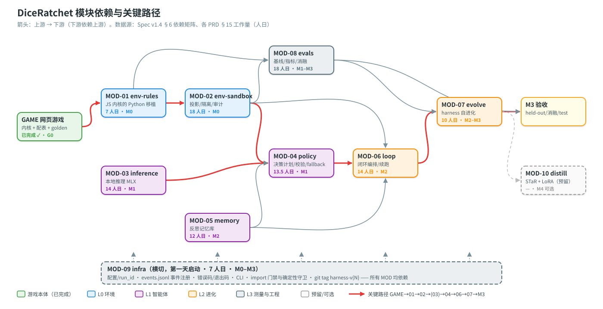

# GameRSI：本地小模型在自建骰子 roguelike 里递归自我改进

> 让一个跑在 Mac 上的 8B 级本地模型，在自己搭建的防作弊沙箱里反复玩一款骰子 roguelike。每一局它都经历"玩 → 验证 → 反思 → 改进自己"（策略记忆、prompt、harness 代码），并用**不可作弊的 held-out 测量**回答一个问题：它真的在变强吗？
>
> 定位：学习 + 作品集 · 状态：**G0 游戏本体已完成；M0 环境已完成并通过验收（2026-10-03），下一步 M1 基线**（排期见 [项目排期](docs/项目排期-GameRSI.md)，验收见 [M0 验收报告](docs/reviews/2026-10-03-M0验收报告.md)）

## 为什么做这个

RSI（Recursive Self-Improvement，递归自我改进）的公开讨论大多停留在论文或思想实验里。本项目想在消费级硬件上**真实跑通一个最小闭环**，并把文献中反复出现的几种失败模式当作一等公民来测量：

- **自我确认环路**：模型"觉得"自己变强了。对策是所有结论只看 held-out 与 test seed，并且 seed 三方隔离（INV-5）。
- **奖励投机 / 环境作弊**：对策是只给白名单观测，harness 代码在受限子进程里执行，蜜罐和泄漏审计全程开启（INV-1～4）。
- **模式坍缩**：对策是监控动作熵曲线与 JSD，做消融，并区分"反思 + 记忆"和"自编辑 harness"各自贡献了多少增益。

背景调研见 [RSI调研纪要](RSI调研纪要.md) 与 [文献综述 2024–2026](文献综述-RSI-2024-2026.md)。

## 当前进度

| 阶段 | 内容 | 状态 |
|---|---|---|
| 调研与计划 | 调研纪要、文献综述、项目计划、指导建议 | ✅ |
| G0 游戏本体 | 网页版骰子 roguelike「破咒骰」：纯函数规则内核 + Node 后端 + 原生前端（`src/game`） | ✅ 49 项测试通过，5 组 golden |
| 规格层 | 模块拆分 Spec v1.4 + GAME-00～02 + MOD-01～09 技术 PRD；已完成一轮评审，36 项决策全部回填 | ✅ |
| M0 环境 | MOD-09 骨架、MOD-01 Python 移植、MOD-02 沙箱 | ✅ 2026-10-03 验收通过（[报告](docs/reviews/2026-10-03-M0验收报告.md)）：5 组 golden 逐行对拍、200 局差分 0 分歧、heuristic 差 0.0pp、G1–G6 全过 |
| M1 基线 | MOD-03 本地推理：后端契约 + 三级 JSON 修复 + 内存预算/并发限流 + 聚合指标 | ✅ 代码落地（`tests/unit/inference` / `tests/integration/test_inference_*` / `tests/golden/inference`）；真实 8B 200 条跑批待权重落盘（`inference robustness`） |
| M1 基线 | 决策策略（MOD-04）+ 三基线 | 计划 → 2027-01-14 |
| M2 闭环 | 反思记忆 + 闭环编排 + harness 自进化 | 计划 → 2027-03-26 |
| M3 测量 | held-out 裁判、消融、多样性、test 终检 | 计划 → 2027-04-22 |

## 系统结构



四层共九个模块，另预留 MOD-10：

| 层 | 模块 | 一句话 |
|---|---|---|
| L0 环境 | MOD-01 env-rules · MOD-02 env-sandbox | JS 内核的 Python 逐位移植；白名单观测投影、受限执行、审计与蜜罐 |
| L1 智能体 | MOD-03 inference · MOD-04 policy · MOD-05 memory | MLX 本地推理 + 约束解码；决策计划、三层校验与 fallback；反思记忆库 |
| L2 进化 | MOD-06 loop · MOD-07 evolve | 闭环编排、断点续跑与成本闸门；harness 候选生成、held-out 裁判、版本化与回滚 |
| L3 测量与工程 | MOD-08 evals · MOD-09 infra | 基线、指标、坍缩监控与消融；配置、事件、CLI、守卫、git |

一局游戏的默认设定是 hard 难度 × 6 关：启发式 bot 的通关率 45.5%，中位数 232 env 步 / 96 个决策点（n=200，seed 1–200；复现命令见 Spec §8.6）。每代共 165 局（训练 30 局 + parent 与 2 个候选的冒烟和 held-out），约 14 小时。详见 [Spec §8.6](docs/模块拆分Spec-GameRSI.md)。

### 七条不变量

任何 PR 都不得违反：

| # | 内容 |
|---|---|
| INV-1 | agent 只能通过 `SandboxEnv` 触达环境 |
| INV-2 | 观测是白名单投影 |
| INV-3 | prompt 只能包含四类白名单上下文 |
| INV-4 | harness 代码受限执行 |
| INV-5 | train / heldout / test 的 seed 三方隔离 |
| INV-6 | 随机性只来自显式 seed |
| INV-7 | 主指标只用环境原生结果（胜负 / 通关数 / 剩余心 / 胜场） |

## 快速开始（游戏本体）

需要 Node ≥ 18，零 npm 依赖：

```bash
cd src/game
node server.js                                          # 浏览器打开 http://127.0.0.1:8080
node --test "tests/**/*.test.js"                         # 全部测试
node scripts/balance.js --n 200 --strategy all --duel    # 平衡报告：通关率 + 学派×敌人矩阵
node scripts/golden-gen.js                               # 重新生成 golden 快照（改规则或配表后运行，并审阅 diff）
```

玩法、架构和内核 API 见 [src/game/README.md](src/game/README.md)。

RSI 训练链路（Python，`gamer_rsi/`）已落地 MOD-01/02/03，命令面对齐 [Spec §4.6](docs/模块拆分Spec-GameRSI.md)：

```bash
python -m gamer_rsi env selftest --seed 1
python -m gamer_rsi inference probe --model mock --mode eval --seed 7 --run-id <id>
python -m gamer_rsi inference bench --model mock --mode eval --seed 7 --n 50 --run-id <id>
python -m gamer_rsi inference robustness --model mock --mode eval --seed 7 --n 200 --run-id <id>
python -m gamer_rsi loop run --generations 3 --k 30 --hitl --run-id <id>   # MOD-06 未落地 → 退出码 2
python -m gamer_rsi eval report --run-id <id> --split heldout --baseline all
```

## CI 门禁

门禁是**一条脚本**，本地与 CI 跑的是同一份（Spec §9 G1–G6 与 INV-1/INV-6 的可执行化）：

```bash
./scripts/ci_gate.sh                  # 快速门（约 1 分钟）：guards + selftest + pytest -m "not slow" + 跨 PYTHONHASHSEED
./scripts/ci_gate.sh --with-slow      # 深门（约 10 分钟）：全量 pytest（5 组 golden / 200 局差分 / 200 局 bot 对拍）+ node 测试 + golden 基准独立性
./scripts/ci_gate.sh --coverage       # 附带覆盖率报告（G1 判据）
```

`guards check` 反例自检也内含其中：门禁必须能拦下 `tests/fixtures/guards/`（退出码 4），否则视为门禁失效。

CI 侧（[.github/workflows/ci.yml](.github/workflows/ci.yml)，Node 22 / Python 3.12）把两者拆成两个作业，**按需触发以省 CI 分钟**（实测：快速门 ≈4.5 分钟、深门 ≈13 分钟）：

| 事件 | 快速门 | 深门（对拍） |
|---|---|---|
| `push` | ✅ | — |
| `pull_request` | ✅ | ✅ |
| tag push（`refs/tags/**`） | ✅ | ✅ |
| 手动 `workflow_dispatch` | ✅ | ✅（可 `-f slow=false` 关掉） |

```bash
gh workflow run ci.yml -F slow=true    # 需要时手动补一次慢门（push 不会自动跑）
```

## 技术栈

| 组件 | 选型 |
|---|---|
| 硬件 | Apple Silicon Mac，24 GB 统一内存 |
| 模型 | 阶段一 Qwen3-8B（MLX 4bit），阶段二 Qwen3-30B-A3B（MoE，Q4） |
| 游戏 | Node.js（原生 http + ESM）、原生 HTML/CSS/JS，内核为整数纯函数 |
| 训练链路 | Python 3.11；确定性 RNG 为 xmur3 + SplitMix64，与 JS 内核逐位一致 |

## 仓库结构

```
.
├── README.md                     # 本文件
├── RSI调研纪要.md                 # 为什么做：理论 / 实证 / 失败模式 / 治理
├── 文献综述-RSI-2024-2026.md
├── 项目计划-GameRSI.md            # 做什么：目标、沙箱纪律、里程碑、验收
├── 项目指导建议-GameRSI.md
├── docs/
│   ├── README.md                 # 文档中心（阅读顺序、PRD 索引）
│   ├── 模块拆分Spec-GameRSI.md    # 模块边界与接口的唯一事实来源（v1.4）
│   ├── 项目排期-GameRSI.md        # 排期与甘特图
│   ├── prd/                      # GAME-00～02、MOD-01～09 技术 PRD
│   ├── reviews/                  # 评审记录
│   ├── assets/                   # 生成的 SVG（模块依赖图、甘特图）
│   └── tools/gen_diagrams.py     # 图表生成脚本（零依赖）
├── schemas/                      # 跨模块 JSON schema（Spec §4.5，MOD-09 登记）
├── harness/                      # harness 工件（Spec §4.4）：config.json（可演化层，v1 = {} 无覆盖）
│                                 #   + prompts/（M1 由 MOD-04 读）+ tools/（M2 由 MOD-07 写）+ versions/v{N}/
├── tests/                        # unit / integration / golden（Python 训练链路）
├── gamer_rsi/                    # RSI 训练链路：env / sandbox / inference / infra
├── scripts/ci_gate.sh            # CI 门禁入口（本地与 CI 同一份）
├── .github/workflows/ci.yml      # CI：gate（快速）+ parity（golden / 差分对拍）
├── src/game/                     # G0 游戏本体：kernel / backend / frontend / content / tests
└── papers/                       # 参考论文 PDF（未纳入 git）
```

## 文档导航

1. [项目计划](项目计划-GameRSI.md)：目标与验收。
2. [模块拆分 Spec](docs/模块拆分Spec-GameRSI.md)：切成几块、怎么接起来。
3. [GAME PRD](docs/prd/)：游戏规则的唯一真相。
4. [MOD PRD](docs/prd/)：每个模块怎么实现。
5. [项目排期](docs/项目排期-GameRSI.md)：什么时候完成。
6. [评审记录](docs/reviews/)：改了什么、为什么改。

文档与代码冲突时，以 Spec 为准。新增的临时决策登记到 Spec §11.2（从 P-31 起编号）。

## 重新生成图表

```bash
python3 docs/tools/gen_diagrams.py    # 写入 docs/assets/*.svg，并打印排期明细表
```

## 说明

- `papers/` 下的 PDF 约 85 MB，没有纳入版本控制，可按文件名中的 arXiv 编号重新下载。
- `runs/`、`logs/`、`.local/` 是运行产物，已写入 `.gitignore`。
- 许可协议未定；在确定之前，代码与文档保留所有权利。
