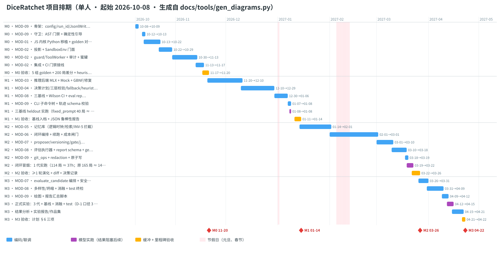

# GameRSI 项目排期

> 版本：v1.0（2026-09-30 18:05）· 状态：基线排期 · 依据：[模块拆分 Spec v1.4](模块拆分Spec-GameRSI.md) §6/§7/§8.6 与各 MOD PRD §15 的工作量估算
> 图表由 [`docs/tools/gen_diagrams.py`](tools/gen_diagrams.py) 生成（零依赖）。修改排期时只改脚本中的 `TASKS`、`START`、`HOLIDAYS`，重跑后把明细表粘回 §4。

## 1. 排期假设

| 项 | 取值 | 说明 |
|---|---|---|
| 人力 | 1 人，全职 | 1 人日 = 1 个工作日；任务串行 |
| 开工日 | 2026-10-08（周四） | 国庆假期后的首个工作日 |
| 节假日 | 2027-01-01 元旦；2027-02-05～02-12 春节 | 春节日期是假设值，拿到官方放假安排后更新 `HOLIDAYS` |
| 工作量来源 | 各 MOD PRD §15 | 9 个模块合计 **113.5 人日**，另加实跑 5 天、报告 4 天 |
| 缓冲 | 每个里程碑按编码量的 10% 设"缓冲 + 验收"任务 | M0 3 天，M1 3.5 天，M2 4 天，M3 1.5 天 |
| 实跑耗时 | Spec §8.6 成本模型 | 每代 165 局约 14 h；M3 全程约 60 h。实跑结果会阻塞后续验收，因此计入主线 |
| 不排入 | GAME 系列（已完成）、MOD-10 / M4（可选） | M4 在 M3 结论出来后再决定是否立项 |

## 2. 里程碑总览

| 里程碑 | 时间 | 工作日 | 覆盖模块 | 验收（Spec §7） |
|---|---|---|---|---|
| G0 | 已完成（2026-09-30） | — | GAME-00/01/02 | 网页游戏可玩；49 项测试通过；5 组 golden |
| **M0** 环境 | ✅ 已完成（实际 2026-10-01 → 2026-10-03；基线计划 2026-10-08 → 2026-11-20） | 31.5（计划） | MOD-09 骨架、MOD-01、MOD-02 | 5 组 golden 逐行对拍；200 局差分一致；Python heuristic 与 JS 相差 ≤ 3pp —— **2026-10-03 验收通过**，见 [reviews/2026-10-03-M0验收报告.md](reviews/2026-10-03-M0验收报告.md) |
| **M1** 基线 | 2026-11-20 → **2027-01-14** | 38 | MOD-03、MOD-04、MOD-08 基线、MOD-09 CLI | random/heuristic/fixed_prompt 三基线的 held-out 分数入档；JSON 鲁棒性报告 |
| **M2** 闭环 | 2027-01-14 → **2027-03-26** | 45 | MOD-05、MOD-06、MOD-07 初版、MOD-08 执行器 | 闭环跑通 ≥ 1 轮演化，产出 diff 与决策记录 |
| **M3** 测量 | 2027-03-26 → **2027-04-22** | 19.5 | MOD-07 评估编排、MOD-08 完整、MOD-09 绘图 | 项目计划 §6 三项验收全部通过 |
| M4（可选） | 待定 | — | MOD-10 | 跨代增益 vs 推理时演化增益 |

合计 **134 个工作日**，约 6.5 个月。

## 3. 甘特图

模块依赖与关键路径见 [assets/module-deps.svg](assets/module-deps.svg)：

## 4. 任务明细

| 里程碑 | 任务 | 模块 | 人日 | 轨道 | 开始 | 结束 |
|---|---|---|---|---|---|---|
| M0 | 骨架：config/run_id/JsonlWriter/错误码 | MOD-09 | 2 | 编码 | 2026-10-08 | 2026-10-09 |
| M0 | 守卫：AST 门禁 + 确定性引导 | MOD-09 | 1.5 | 编码 | 2026-10-12 | 2026-10-13 |
| M0 | JS 内核 Python 移植 + golden 对拍 | MOD-01 | 7 | 编码 | 2026-10-13 | 2026-10-22 |
| M0 | 投影 + SandboxEnv 门面 | MOD-02 | 5.5 | 编码 | 2026-10-22 | 2026-10-29 |
| M0 | guard/ToolWorker + 审计 + 蜜罐 | MOD-02 | 10.5 | 编码 | 2026-10-30 | 2026-11-13 |
| M0 | 集成 + CI 门禁接线 | MOD-02 | 2 | 编码 | 2026-11-13 | 2026-11-17 |
| M0 | M0 验收：5 组 golden + 200 局差分 + heuristic ≤3pp | — | 3 | 验收 | 2026-11-17 | 2026-11-20 |
| M1 | 推理后端 MLX + Mock + GBNF/修复 | MOD-03 | 14 | 编码 | 2026-11-20 | 2026-12-10 |
| M1 | 决策计划/三层校验/fallback/heuristic | MOD-04 | 13.5 | 编码 | 2026-12-10 | 2026-12-29 |
| M1 | 三基线 + Wilson CI + eval report 骨架 | MOD-08 | 5 | 编码 | 2026-12-30 | 2027-01-06 |
| M1 | CLI 子命令树 + 轨迹 schema 校验 | MOD-09 | 1.5 | 编码 | 2027-01-07 | 2027-01-08 |
| M1 | 三基线 heldout 实跑（fixed_prompt 40 局 ≈ 4h） | — | 0.5 | 实跑 | 2027-01-08 | 2027-01-08 |
| M1 | M1 验收：基线入档 + JSON 鲁棒性报告 | — | 3.5 | 验收 | 2027-01-11 | 2027-01-14 |
| M2 | 记忆库（逻辑时钟/检索/INV-5 拦截） | MOD-05 | 12 | 编码 | 2027-01-14 | 2027-02-01 |
| M2 | 闭环编排 + 续跑 + 成本闸门 | MOD-06 | 14 | 编码 | 2027-02-01 | 2027-03-01 |
| M2 | proposer/versioning/gate/judge | MOD-07 | 7 | 编码 | 2027-03-01 | 2027-03-10 |
| M2 | 评估执行器 + report schema + generations.csv | MOD-08 | 6 | 编码 | 2027-03-10 | 2027-03-18 |
| M2 | git_ops + redaction + 原子写 | MOD-09 | 1 | 编码 | 2027-03-18 | 2027-03-19 |
| M2 | 闭环冒烟：1 代实跑（165 局 ≈ 14h） | — | 1 | 实跑 | 2027-03-19 | 2027-03-22 |
| M2 | M2 验收：≥1 轮演化 + diff + 决策记录 | — | 4 | 验收 | 2027-03-22 | 2027-03-26 |
| M3 | evaluate_candidate 编排 + 安全用例 | MOD-07 | 3 | 编码 | 2027-03-26 | 2027-03-31 |
| M3 | 多样性/坍缩 + 消融 + test 终检 | MOD-08 | 7 | 编码 | 2027-03-31 | 2027-04-09 |
| M3 | 绘图 + 报告汇总脚本 | MOD-09 | 1 | 编码 | 2027-04-09 | 2027-04-12 |
| M3 | 正式实验：3 代 + 基线 + 消融 + test（≈60h） | — | 3 | 实跑 | 2027-04-12 | 2027-04-15 |
| M3 | 结果分析 + 实验报告/作品集 | — | 4 | 编码 | 2027-04-15 | 2027-04-21 |
| M3 | M3 验收：计划 §6 三项 | — | 1.5 | 验收 | 2027-04-21 | 2027-04-22 |

## 5. 关键路径与提速选项

**关键路径**：GAME → MOD-01 → MOD-02 →（MOD-03）→ MOD-04 → MOD-06 → MOD-07 → M3。单人开发时所有任务都在关键路径上，下面几项是能压缩工期的地方：

| 选项 | 节省 | 代价 / 前提 |
|---|---|---|
| 加 1 名协作者，并行做 MOD-03（与 MOD-01/02 同步）和 MOD-08（与 MOD-04/05 同步），即 Spec §6 标注的并行机会 | 约 35 个工作日，M3 可提前到 2027-03 上旬 | 需要按 Spec §4.7 签名表先定好接口桩；两人都要熟悉 INV-1～7 |
| MOD-02 的审计规则集和蜜罐只做 M0 必需部分（v1.0 规则），v1.1 规则推到 M1 以后 | 约 3 个工作日 | M0 期间泄漏覆盖面变小；G4 蜜罐自测必须保留 |
| M2 冒烟改用 K=10、H=20 的小配置 | 约 0.5 天实跑 | 冒烟不作为结论，只验证闭环能跑通 |
| 实跑放在夜间或周末 | 实跑的 5 天大部分可以不占工作日 | 需要 `--resume` 稳定（MOD-06 T-06-7/8），并做好断电保护 |

## 6. 排期风险

| 风险 | 影响 | 应对 |
|---|---|---|
| 实测单次决策耗时 `t_d` 高于 Spec §8.6 的估计值 | M2/M3 实跑时间成倍增加 | M1 验收时用 `inference bench` 实测并回写 §8.6；超预算时先下调 C（候选数）和 S，再考虑缩小 H |
| MOD-02 工作量最大（18 人日），且安全相关代码返工概率高 | M0 延期 | 先交付投影和门面，让 MOD-03/04 可以提前联调；guard 与审计随后补齐 |
| 8B 模型在 hard × 6 关下几乎零通关 | 演化增益测不出来 | M1 基线出来后，如果 fixed_prompt 通关率 < 5%，改用 medium × 6 关（GAME D-34 已支持），并在 Spec §8.6 登记 |
| 春节前后 MOD-06 跨假期 | 上下文切换 | 春节前完成 MOD-06 的单测部分，节后直接进入联调 |
| M3 test 集只能解锁一次 | 失误后无法重来 | M3 验收前先在 H2 篮子上完整彩排一遍 |

## 7. 跟踪方式

- 每完成一个任务，在对应模块 PRD 的 §15 中标注实际人日；每周把实际进度与本表对比一次。某里程碑累计偏差超过 20% 时，重排后续里程碑并在 §8 记录。
- 里程碑验收以 Spec §7 与 §9 质量门为准，验收结论写入 `docs/reviews/`。

## 8. 变更记录

| 版本 | 时间 | 变更 |
|---|---|---|
| v1.0 | 2026-09-30 18:05 | 首版基线排期：单人、2026-10-08 开工、M3 预计 2027-04-22 |
| v1.1 | 2026-10-03 | **M0 实际完成情况回写（不重排基线，M1–M3 日期保持 v1.0）**。M0 三个模块（MOD-09 骨架、MOD-01、MOD-02）的实际代码于 **2026-10-01 → 2026-10-03** 提交完毕（`5d3574c` → `e35279e`，7 个提交），早于基线开工日 2026-10-08；2026-10-03 按 Spec §7/§9 完成验收（[M0 验收报告](reviews/2026-10-03-M0验收报告.md)），三条验收判据与 G1–G6 全部通过，验收发现的 6 项缺陷已于同日修复。**实际人日未单独记工**：按提交时间窗折算 ≤ 3 人日，与计划 31.5 人日偏差 ≥ 90%（§7 的 20% 阈值被触发，但重排推迟到 M1 开工前与 MOD-03 实测 `t_d` 一并决定）。M0 的 `MOD-09 CLI` 子命令树（基线归 M1）已提前随 M0 交付。**后续动作**：M1 起在 PRD §15 逐任务记录实际人日。 |
